<div align="center">

# 🎓 Edu Learn Platform

**Plateforme e-learning multi-rôles développée avec Laravel 12 : cours, quiz, examens en ligne et certificats PDF.**


</div>

---

## 📖 Présentation

**Edu Learn Platform** est une application web e-learning réalisée dans le cadre d'un projet académique. Elle permet aux **administrateurs** de gérer la plateforme, aux **professeurs** d'organiser leurs cours et leurs évaluations, et aux **étudiants** de suivre des formations, passer des examens en ligne et obtenir un certificat.

Chaque type d'utilisateur dispose d'un **espace dédié** avec des fonctionnalités adaptées à son rôle.

---

## ✨ Fonctionnalités

### 👨‍💼 Administrateur
- Tableau de bord d'administration
- Gestion des professeurs
- Gestion des cours
- Consultation de tous les utilisateurs inscrits
- Affichage des informations détaillées des professeurs et des étudiants

### 👩‍🏫 Professeur
- Tableau de bord personnel
- Gestion des cours dont il est responsable
- Ajout d'étudiants à ses cours
- Création de quiz et gestion des évaluations
- Consultation des utilisateurs associés à ses cours
- Blocage et déblocage des étudiants de ses cours
- Gestion de son profil

### 🎓 Étudiant
- Création de compte et authentification
- Tableau de bord personnel
- Consultation des cours disponibles et des cours suivis
- Inscription aux cours
- Accès aux examens et aux quiz après inscription
- Obtention d'un **certificat PDF** à la fin du parcours
- Modification des informations du profil

---

## 📸 Aperçu de l'application

### 🔐 Authentification

| Connexion | Inscription |
|:---:|:---:|
| 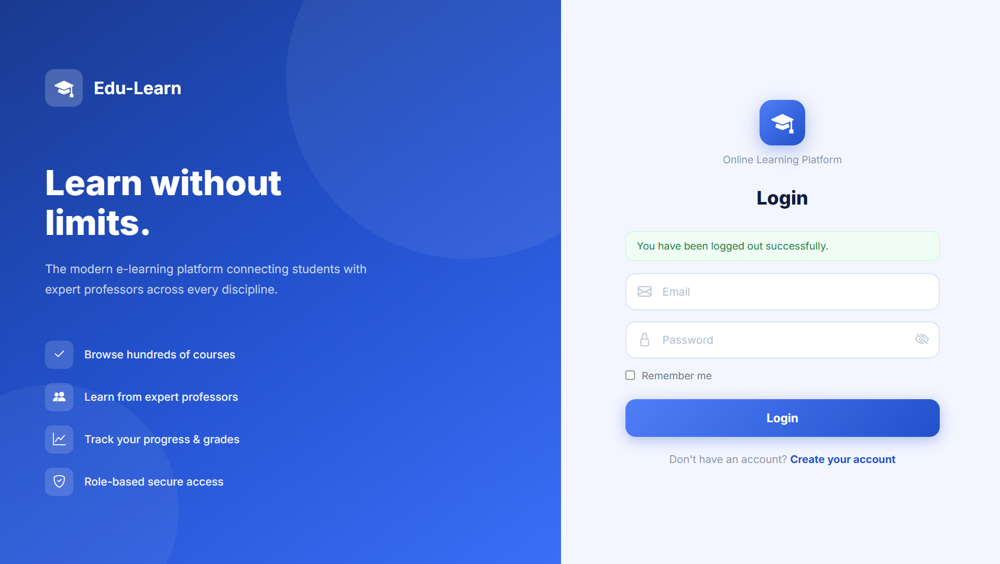 | 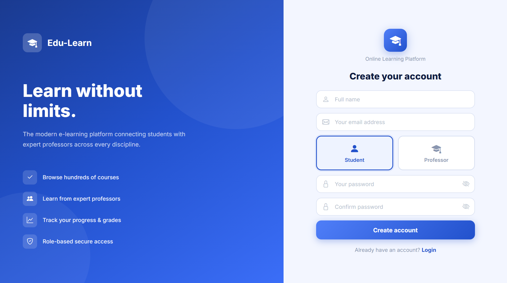 |

### 👨‍💼 Espace Administrateur

| Tableau de bord | All users |
|:---:|:---:|
| 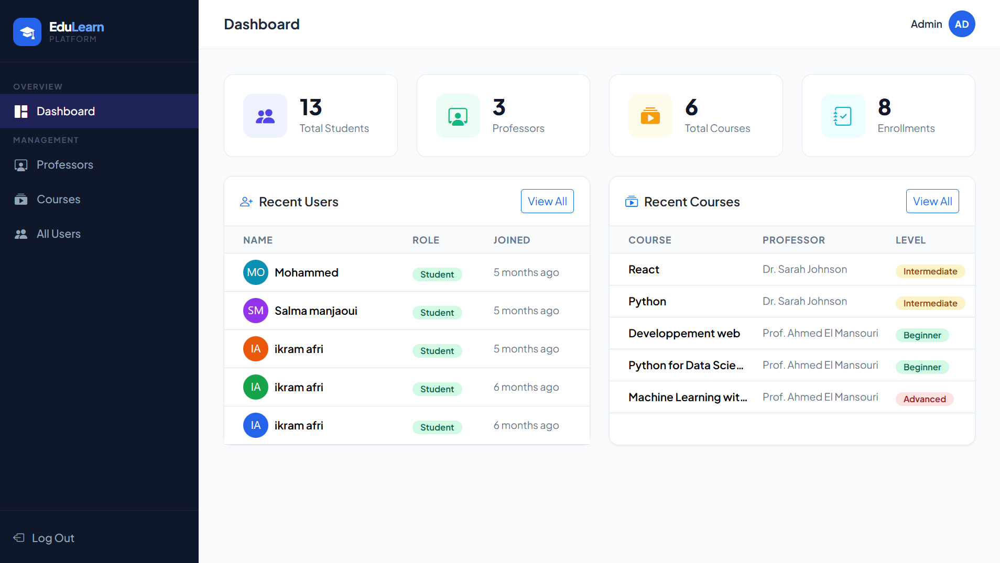 |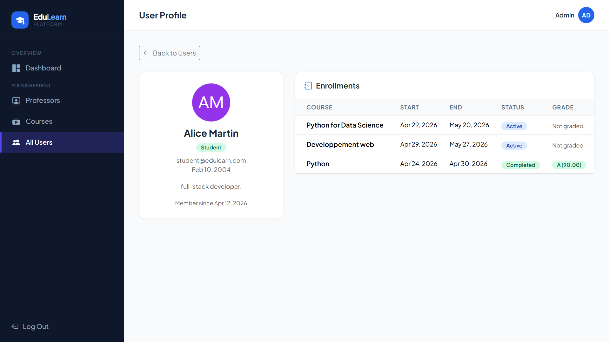

| Gestion des cours |
|:---:|
| 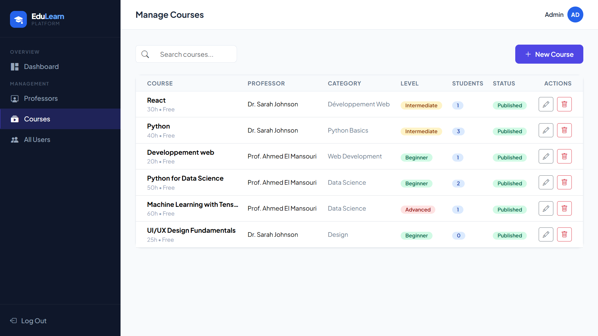 |

### 👩‍🏫 Espace Professeur

| Tableau de bord | Création de quiz |
|:---:|:---:|
| 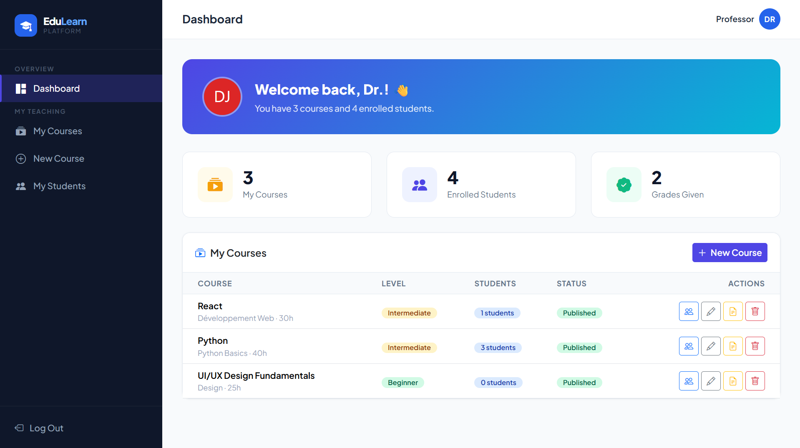 | 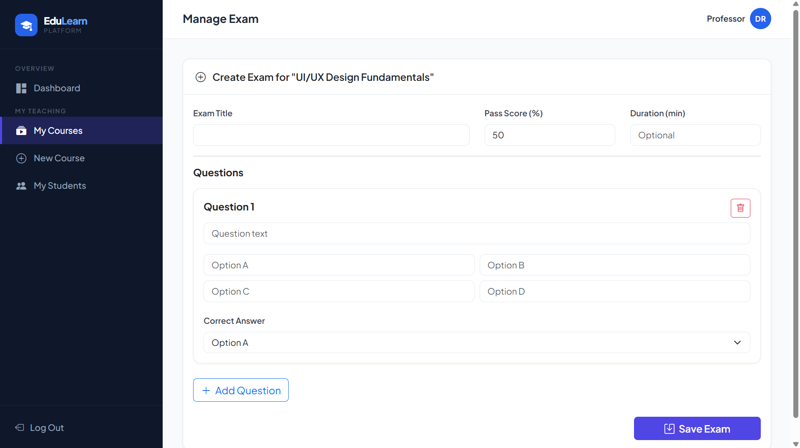 |

| Gestion des étudiants |
|:---:|
| 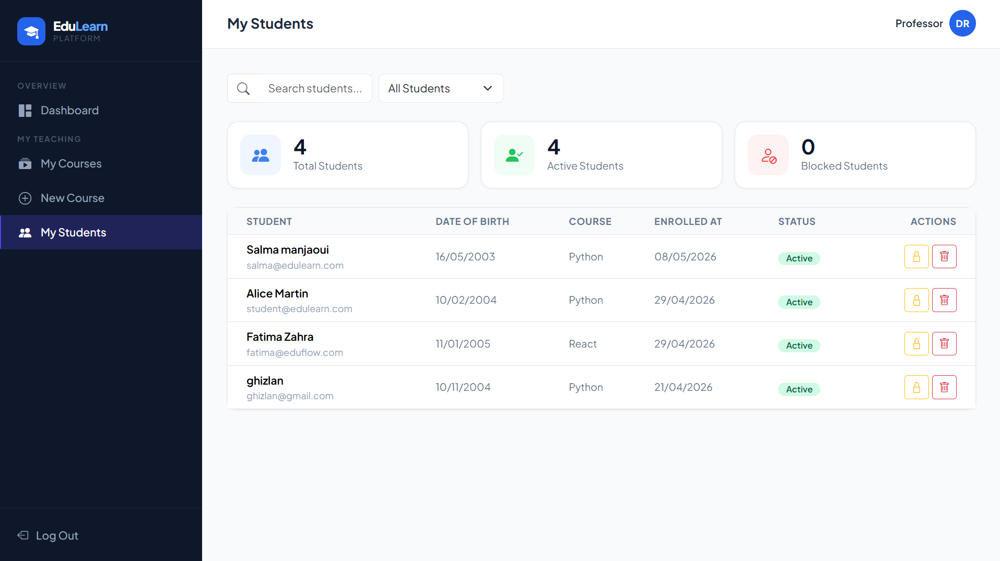 |

### 🎓 Espace Étudiant

| Tableau de bord | Catalogue des cours |
|:---:|:---:|
| 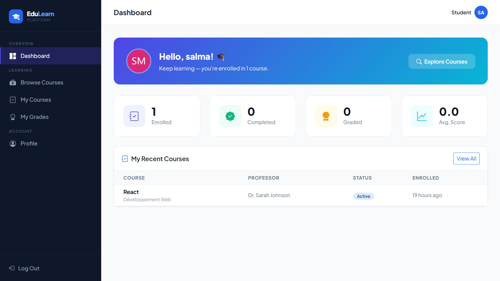 | 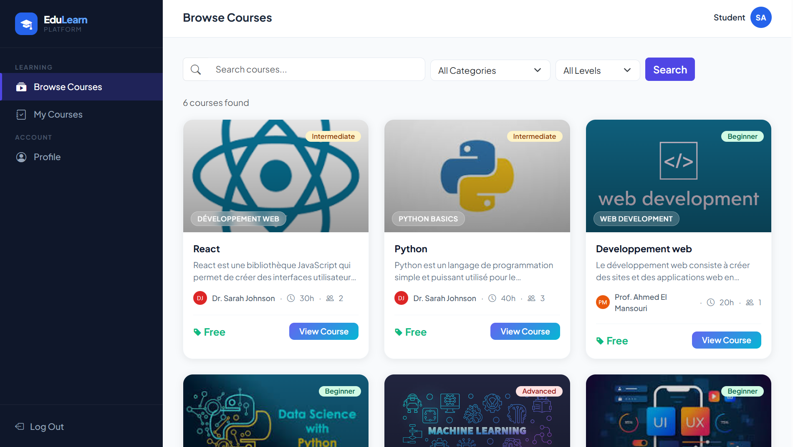 |

| Passage d'un examen | Certificat PDF |
|:---:|:---:|
| 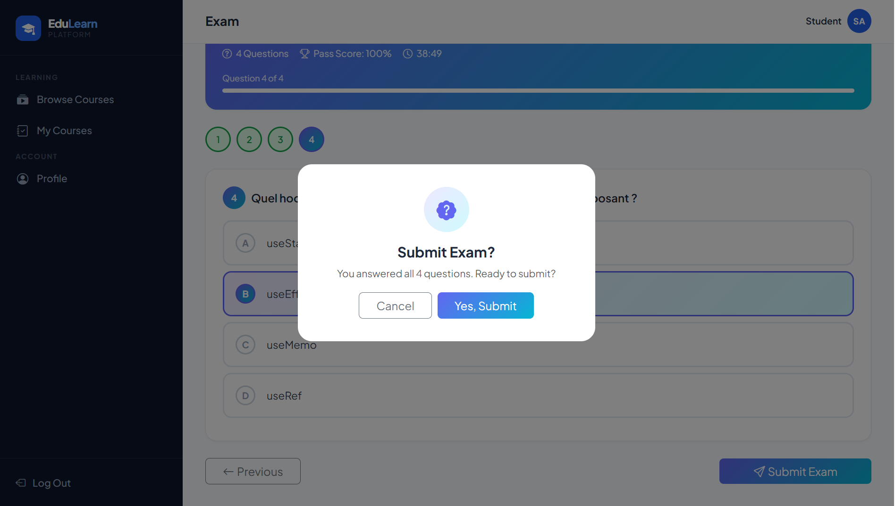 | 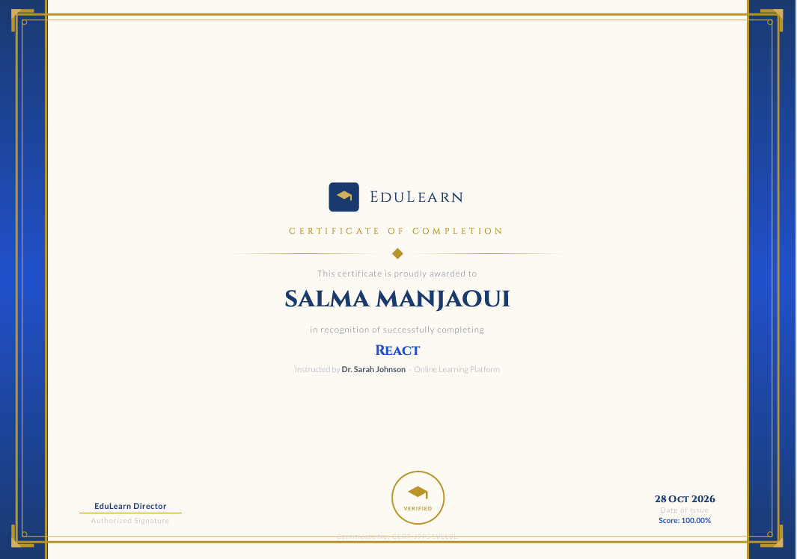 |

---

## 🛠️ Technologies utilisées

| Technologie | Rôle |
|---|---|
| **PHP** | Langage côté serveur |
| **Laravel 12** | Framework backend (architecture MVC) |
| **Blade** | Moteur de templates |
| **Bootstrap** | Mise en page et design responsive |
| **MySQL** | Base de données relationnelle |
| **Laravel DomPDF** | Génération des certificats PDF |
| **Composer / npm** | Gestion des dépendances |

---

## 🧩 Architecture

La plateforme repose sur **trois espaces** :

| Espace | Responsabilités |
|---|---|
| 🔴 **Admin** | Administration des professeurs, des cours et des utilisateurs |
| 🟠 **Professeur** | Organisation des cours, gestion des étudiants, création des évaluations |
| 🟢 **Étudiant** | Inscription aux cours, apprentissage, examens et certificats |

---

## 📂 Structure du projet

```
edu-learn-platform/
│
├── app/
│   ├── Http/
│   │   ├── Controllers/
│   │   │   ├── Admin/
│   │   │   │   ├── DashboardController.php
│   │   │   │   ├── ProfessorController.php
│   │   │   │   ├── CourseController.php
│   │   │   │   └── UserController.php
│   │   │   ├── Professor/
│   │   │   │   ├── DashboardController.php
│   │   │   │   ├── CourseController.php
│   │   │   │   ├── QuizController.php
│   │   │   │   └── StudentController.php
│   │   │   └── Student/
│   │   │       ├── DashboardController.php
│   │   │       ├── CourseController.php
│   │   │       ├── ExamController.php
│   │   │       └── CertificateController.php
│   │   └── Middleware/
│   │       └── RoleMiddleware.php
│   └── Models/
│       ├── User.php
│       ├── Course.php
│       ├── Quiz.php
│       └── Question.php
│
├── database/
│   ├── migrations/
│   └── seeders/
│
├── resources/
│   └── views/
│       ├── layouts/
│       ├── auth/
│       ├── admin/
│       ├── professor/
│       ├── student/
│       └── certificates/
│
├── routes/
│   └── web.php
│
├── public/
├── .env.example
├── composer.json
├── package.json
└── README.md
```

---

## 🚀 Installation

### Prérequis

- PHP 8.2 ou supérieur
- Composer
- MySQL
- Un environnement local (ex. XAMPP)
- Node.js et npm

### Étapes

**1. Cloner le dépôt**
```bash
git clone https://github.com/manjaouisalma/edu-learn-platform.git
cd edu-learn-platform
```

**2. Installer les dépendances PHP**
```bash
composer install
```

**3. Créer le fichier d'environnement**
```bash
cp .env.example .env
```
Sous Windows : `copy .env.example .env`

**4. Créer la base de données MySQL, puis configurer le `.env`**
```env
DB_CONNECTION=mysql
DB_HOST=127.0.0.1
DB_PORT=3306
DB_DATABASE=eduflow
DB_USERNAME=root
DB_PASSWORD=
```

**5. Générer la clé de l'application**
```bash
php artisan key:generate
```

**6. Exécuter les migrations**
```bash
php artisan migrate --seed
```

**7. Compiler les ressources front-end**
```bash
npm install
npm run build
```

**8. Lancer le serveur**
```bash
php artisan serve
```

Ouvrir ensuite : **http://127.0.0.1:8000**

> ⚠️ La base de données doit être créée avant de lancer les migrations.

---

## 🔑 Comptes de démonstration

| Rôle | E-mail | Mot de passe |
|---|---|---|
| Administrateur | `admin@edulearn.com` | `password` |
| Professeur | `professeur@edulearn.com` | `password` |

Les étudiants peuvent créer leur propre compte depuis l'application.

> 🔒 Ces identifiants sont réservés à la **démonstration locale**. Ne jamais les utiliser en production.

---

## 🎯 Compétences acquises

- Développement d'une application web complète avec **Laravel (MVC)**
- Gestion des utilisateurs et des **permissions par rôle**
- Conception et manipulation d'une **base de données relationnelle**
- Génération de **documents PDF** dynamiques
- Création d'interfaces adaptées à chaque profil d'utilisateur

---

## 👩‍💻 Auteur

**Salma Manjaoui**
Diplômée en Ingénierie des Systèmes Informatiques

[](https://github.com/manjaouisalma)